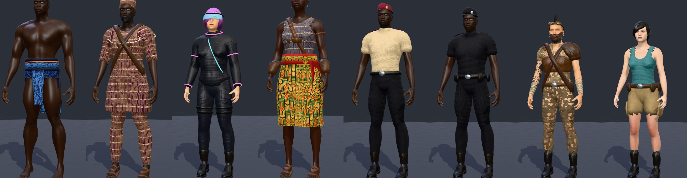
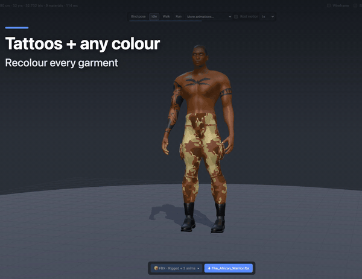

# 3D Gen

**Open-source, self-hosted generator for realistic 3D human characters: rigged, animated and ready for your engine.**

Shape a body, dress it, give it hair, a beard, tattoos and a weapon, pick from 39 animations, and export **GLB, FBX, OBJ or a ZIP bundle**. It runs entirely on your machine, in the browser or headless from the command line, with no accounts, credits or limits.



<p align="center"></p>

<!-- Replace DEMO_VIDEO_URL with the video's link (e.g. attach 3d-gen-demo.mp4 to a GitHub release, or drag it into this README on GitHub). -->
> 🎬 **[Watch the 105-second demo](DEMO_VIDEO_URL)**: presets, sliders, hair and tattoos, animations, weapons and export.

## Why self-hosted?

Online character generators are convenient, but you rent them. 3D Gen is yours:

| | Online platforms | 3D Gen |
| --- | --- | --- |
| Cost | Subscriptions, credits or per-export fees | Free, MIT-licensed |
| Limits | Monthly export or generation caps | Unlimited, as many characters as your machine can make |
| Privacy | Your projects live on someone's server | Nothing leaves your computer |
| Offline | Needs an internet connection | Works offline once set up |
| Automation | Usually a web UI only, sometimes a paid API | Scriptable CLI and a TypeScript API: generate hundreds of NPCs in a loop |
| Ownership | Licence terms can change or restrict use | CC0 base assets: use exports commercially, no attribution |
| Customisation | What the vendor ships | Fork it: add garments, hairstyles, animations, presets, export rules |
| Longevity | The service can shut down or change pricing | The code and your pipeline stay with you |

## Features

- **Realistic humans:** built on the CC0 MakeHuman dataset: 900+ morph targets, 219 detail sliders, 20 photo-based skins across age, ethnicity and sex, three detail levels (≈5k to 120k triangles).
- **19 presets:** athletes, a detective, a secret agent, a soldier, a cyberpunk hacker, a wasteland survivor, African warriors (Yoruba, Maasai, Zulu, Dahomey), and Nigerian Police and FRSC officers. Plus one-click, reproducible random characters.
- **Clothing:** MakeHuman outfits, or mix-and-match tops, bottoms, wrappers, uniforms and 30+ accessories. Generated fabrics (kente, aso-oke, ankara, adire, camo, leather…), all recolourable.
- **Hair and looks:** MakeHuman hairstyles plus buzz cut, punk mohawk, cornrows and box braids. Stubble, mustache, goatee and beards. Tattoos. Earrings.
- **Auto-rigging:** game rig (Mixamo bone names; Unity Humanoid / Unreal / Mixamo compatible), lite or full skeleton, A- or T-pose, optional face bones, a `WeaponR` socket.
- **39 animations:** locomotion, turns, jumps, combat, emotes, a full shooter set and melee, with optional root motion. One evaluator drives the preview and the exports, so what you see is what you export.
- **Weapons:** rifle, pistol, sword and knife, held on the socket. Export them in the hand or as separate props.
- **Exports you can trust:** an export panel that lists every file before you download it: static, rigged, or rigged + animations; one file or one per clip; Unity `model@clip` and Godot loop naming.
- **Tested:** `npm test` builds 240 characters and validates every format. `npm run test:gltf` loads the GLBs in three.js and checks every bone of every clip.

## Quick start

Works on **Windows, macOS and Linux**. Requirements: **Node 20+** and **git**. The app runs in any current Chrome, Edge, Firefox or Safari.

```bash
git clone https://github.com/olatunde85/3d-gen.git
cd 3d-gen
npm install
npm run setup-assets   # one-time: downloads CC0 MakeHuman data (~420 MB) and builds public/assets (~85 MB)
npm run dev            # open http://localhost:5173
```

On Windows, run the same commands in PowerShell, Command Prompt or Git Bash.

Production build (static files you can host anywhere, e.g. an internal server or GitHub Pages):

```bash
npm run build          # -> dist/  (set BASE_PATH=/sub/path/ when hosting under a sub-path)
```

## Command line

Generate characters without opening a browser, for batch jobs, CI or asset pipelines:

```bash
npm run export -- --preset "The Soldier" --detail high --out out
npm run export -- --random 42 --formats glb,fbx
npm run export -- --params my.params.json          # regenerate from a saved params.json
npm run export -- --all-presets --out out
```

Every exported zip includes the character's `params.json`, so any character can be regenerated or tweaked later.

## Licensing

- **Code:** [MIT](LICENSE).
- **Character data:** MakeHuman assets, CC0 1.0 (public domain); see [scripts/ASSETS_LICENSE.txt](scripts/ASSETS_LICENSE.txt). They are downloaded by `setup-assets`, not stored in this repository.
- **Your exports:** yours. Use them in commercial and non-commercial projects without attribution.

## Contributing

Garments, hairstyles, animations, presets, engine notes and bug reports are all welcome: see [CONTRIBUTING.md](CONTRIBUTING.md).

---

## How it works

Realism comes from data, not hand-built shapes. The generator uses the MakeHuman
anatomy dataset, which is CC0 (public domain) since 2020:

- **Base mesh:** an artist-made, animation-ready human (13,378 quads).
- **Morph targets:** 935 targets. Macro controls (gender, age, muscle, weight, height,
  proportions, ethnicity, breast) blend across a lattice of targets, exactly like MakeHuman.
  219 detail sliders (head shape, nose, mouth, eyes, ears, chin, cheeks, torso, limbs…)
  add targets on top. Left/right pairs are merged into one symmetric slider.
- **Proxies:** eyes, eyebrows, eyelashes, 10 hairstyles, 12 outfits, 6 shoes and 2 hats.
  Each vertex is fitted to a triangle of body vertices (`.mhclo`), so clothing follows any
  body shape. Skin under clothing is removed to prevent poke-through.
- **Textures:** 20 photo-based skins (young / middle-aged / old × African / Asian / Caucasian ×
  male / female, picked automatically), plus diffuse and normal maps for clothes, alpha
  textures for hair and lashes, and 9 eye colours.

## Detail levels

| Level | Body | Typical triangles |
| --- | --- | --- |
| Low | MakeHuman game proxy (~1.6k quads) | ~5–10k |
| Medium | Full base mesh | ~30–40k |
| High (HD) | Catmull-Clark subdivided body + clothing | ~100–120k |

## Export formats

| Format | Units | Notes |
| --- | --- | --- |
| `.glb` | metres | glTF 2.0, PBR materials, textures embedded, alpha mask for hair and lashes |
| `.fbx` | centimetres | Binary FBX 7.4, quad topology, textures embedded (Unity, Unreal, Blender) |
| OBJ (`_obj.zip`) | metres | `.obj` + `.mtl` + `textures/`, quad topology |
| `.zip` | — | All of the above plus `params.json` (to regenerate), `preview.png`, README and LICENSE |

All formats use +Y up, with the character facing +Z and the feet at y = 0.
`scripts/blender_check.py` imports exports into Blender and renders previews.

## Architecture

```
scripts/build-assets.ts   MakeHuman data -> public/assets (packs, textures, thumbnails, catalog.json)
src/core/
  assets.ts    asset pack formats + AssetLibrary (fetch in browser, fs in Node)
  pack.ts      tiny gzip'd binary container (JSON header + typed arrays)
  params.ts    HumanParams, presets, seeded randomizer
  morph.ts     macro + detail-slider target weighting, target application
  human.ts     buildHuman(): morph, proxy fitting, subdivision, materials, skeleton
  geometry.ts  compaction, Catmull-Clark subdivision, normals
  mesh.ts      MeshData (multi-material, triangles + original polygons)
  garments/    procedural clothing (shells, hull rings, generated fabrics)
  looks/       tattoos + stubble/shaved scalps (skin overlay), procedural hairstyles, beards, earrings
  props/       weapons (rifle, pistol, sword, knife)
  rig/         skeletons, auto-skinning, T-pose, WeaponR socket
  anim/        clips + the shared evaluator (FK, arm IK, grounding)
src/export/    glb.ts, fbx.ts (binary writer), obj.ts, index.ts (bundling)
src/app/       three.js viewer + catalog-driven UI
```

## Clothing

Choose a full MakeHuman outfit, or **Separate pieces**:

- **Tops:** tank top, fatigue shirt, uniform shirt (short or long sleeves, with epaulettes), techwear jacket, tattered shirt, sleeveless tunic, woven tunic (buba), or none (shirtless/topless).
- **Bottoms:** briefs, cargo shorts, fatigue/uniform/techwear/tattered pants, loose trousers (sokoto), wrappers (knee or ankle length), Zulu hide aprons, a loincloth with front and back panels, or none.
- **Accessories:** belts, utility belt, waist sash, shuka shoulder drape, crossed straps, amulet bandolier, leather armor, tactical vest, reflective hi-vis vest, beret, beaded collar, bead and cowrie necklaces, protective charms, brass cuffs, beaded and cowrie arm bands, arm guards, fur bands, fur headband with feathers, beaded headband, fila cap, combat helmet, holo visor, neon accents, goggles, arm wraps, wrist watch.
- **Footwear:** MakeHuman shoes, sandals, combat boots, or barefoot.
- **Fabrics:** generated, tileable, with normal maps: kente, aso-oke, ankara, adire, shuka plaid, cowhide, leopard, camo, MOLLE, leather, techwear, tattered.

Every piece has editable colours (Colour + Accent, e.g. epaulettes, badge, reflective tape) and, where it has several, a pattern choice. Presets include **Nigerian Police** (all-black uniform, short sleeves, beret, duty belt) and **FRSC** (beige short-sleeve shirt after the FRSC No. 5b dress, black trousers, maroon beret, service belt) officers. The uniform shirt comes in short and long sleeves, and a hi-vis reflective vest is available as an accessory.

Garments are grown from the body surface or wrapped around it with convex-hull rings, so they fit every body shape.

## Hair, beards, tattoos, earrings

- **Hairstyles:** MakeHuman hair, plus generated **buzz cut**, **punk mohawk** (liberty spikes, shaved sides), **cornrows** and **box braids**. These follow every head shape and take their own *Hair colour*.
- **Facial hair:** stubble, mustache, goatee, short beard or full beard, with a *Beard colour*. Beards are hair cards (alpha-masked strips, the usual game approach) over a stubble layer. With facial bones on, they follow the jaw.
- **Tattoos** (adults 18+ only): tribal armband, full sleeve, forearm bands, chest piece, back piece, and Yoruba-style cheek marks, with an ink colour.
- **Earrings:** studs, small hoops or big hoops, in gold or silver.

Tattoos, stubble and shaved scalps are painted into one RGBA "Skin details" texture in the body's UV space. It sits on a thin copy of the skin they cover, 0.4 mm above it. Designs are defined on the unmorphed base mesh, so they keep their shape on every body and the texture is cached while you move sliders.

**Adult-only options:** topless and bottomless (no underwear) are only possible for characters aged 18+. Under-18 female characters always get a top, and every under-18 character keeps underwear. Bodies are anatomically neutral (no genital geometry).

## Rigging

Characters are rigged automatically, with no markers to place. The skeleton is built on the generated body's joints, and MakeHuman's CC0 skin weights are mapped onto it. Every clothing, hair and accessory vertex then gets weights: proxies through their reference vertices, garments through the base mesh or the nearest body vertices. Weights follow through subdivision.

| Option | Choices |
| --- | --- |
| Skeleton | **Game rig** (65 bones, Mixamo names; retargets to Mixamo / Unity Humanoid / Unreal), **lite** (25 bones, no fingers), **full MakeHuman** (163 bones incl. face), none. Each also gets a `WeaponR` socket bone (below). |
| Facial bones | jaw + eyes |
| Rest pose | A-pose (natural) or T-pose (re-posed with linear blend skinning) |

**Weapon socket:** every rig has a `WeaponR` bone under the right hand, centred in the closed grip. Its +Y axis runs out of the top of the fist (the grip and blade axis) and +Z toward the knuckles. Parenting a prop to it is how games usually attach weapons, so you can swap weapons in the engine without re-exporting the character.

GLB exports a joint hierarchy, inverse bind matrices and JOINTS_0/WEIGHTS_0. FBX exports LimbNodes, Skin/Cluster deformers and a bind pose. The ZIP adds `<name>.rig.json`, the bind pose in an engine-neutral form. The viewer can test the rig with poses (arms up, wave, squat, fist) and motions (idle, walk). `scripts/blender_rig_check.py` imports the exports into Blender and checks that posing deforms the mesh correctly.

## Exporting

The export bar always shows what you're about to get, for example `📦 FBX · Rigged + 3 anims`, with a Download button named after the exact file. Click the summary to open the **Export panel**:

1. **What to export**
   - **Static model:** mesh + textures.
   - **Rigged model:** + skeleton and skin weights.
   - **Rigged + animations:** + the clips you pick.
2. **Skeleton:** game rig (65 bones, Mixamo names), lite (25), or full MakeHuman (163); A- or T-pose bind; optional jaw and eye bones.
3. **Animations:** tick clips by category (▶ previews each one), then choose **One file, all clips inside** or **Zip: one file per clip**.
   - Per-clip files follow Unity's `model@clip.fbx` convention and are skeleton-only unless "Include the mesh" is on.
   - **Root motion** makes walk, run and strafe travel instead of playing in place.
4. **Weapon** (when the character holds one): **In the hand**, one file with the weapon skinned to `WeaponR`; or **Separate prop file**, which exports the character without the weapon plus `<name>_<weapon>.glb/.fbx`. The prop's origin is at the grip, so it attaches to `WeaponR` with zero offset.
5. **Format:** GLB, FBX, OBJ (static only; disabled for rigged modes), or All formats (zip).
6. **You will download:** the exact file name and every file in it, each with a description: triangles, textures, bones and pose, which clips, and skeleton-only or not. Notes explain any adjustment, for example that OBJ can't hold a rig.

**Using the GLB in a game, without Blender:**
- **Web (three.js, Babylon.js, PlayCanvas) and Godot 4** load the rigged, animated GLB directly. `npm run test:gltf` proves this for three.js: it exports through the real pipeline, loads the file with the stock `GLTFLoader` + `AnimationMixer` in headless Chrome, and checks every bone of every clip against the generator. Results for all four rig variants: within 0.04°, with exact root positions, and the skinned mesh deforms.
- **Godot:** tick *Mark looping clips in their names* in the Export panel. Clips are then named `Walk-loop` and so on, which Godot imports as looping automatically.
- **Unity:** use **FBX**. It imports natively, the Mixamo bone names map to the Humanoid rig, and you tick *Loop Time* on looping clips. GLB in Unity needs the glTFast package.
- **Unreal 5:** use **FBX**. The skeleton has no separate root bone above Hips (like Mixamo), so Unreal's root-motion setup may need one added.
- **Every engine:** glTF has no loop flag, so set looping clips to loop. Loops play in place unless you export with Root motion.

The plan is computed by `planExport()` (`src/export/plan.ts`) and executed by `runExport()`, so the download always matches the list. Zips also contain `params.json` (to regenerate the character), `rig.json`, a README listing the files, the licence and a preview image.

## Animation

The character loads playing **Idle**, a rigged idle with relaxed arms. The animation bar at the top of the viewport plays the clips:

| Category | Clips |
| --- | --- |
| Idle & stance | Idle, Crouch idle (loops) |
| Locomotion | Walk, Run, Walk backwards, Strafe left/right (loops; in place, or with root motion) |
| Actions | Jump, Fall, Punch, Hit reaction (one-shots) |
| Emotes | Wave, Cheer (loops) |
| Turns | Left/right 45° and 90°, full 360° (one-shots: hip yaw with stepping feet) |
| Shooter | Pistol idle (low ready), pistol aim, pistol fire; rifle idle (low ready), aim idle, fire single, fire full-auto, reload, aiming walk / walk back / strafe left / strafe right, rifle run, sprint, crouch aim, crouch walk; throw grenade, death (fall forward) |
| Melee | Sword idle (guard), sword slash, sword block (in Actions) |

**Weapons:** pick an assault rifle, pistol, sword or combat knife under *Weapon*. It is held in the right hand on the `WeaponR` socket, and the viewer switches to the matching idle. Firearms are fitted to the aiming pose: the barrel lines up with the chest's forward axis, and the rifle's handguard sits under the support hand. The shooter clips also work without a weapon, with your own prop parented to `WeaponR`. Hands are placed with two-bone arm IK: the right hand first, then the left hand onto the rifle's handguard wherever the rifle actually is, sliding along it if a pose would over-stretch the arm, so the hands stay on the weapon on every body shape and skeleton. Fingers curl toward the palm, which is detected from each hand's joints, so fists and grips close correctly on A- and T-pose binds.

Feet are grounded automatically (crouch, landing, steps), and switching clips in the viewer crossfades over 0.25 s.

Clips are defined once (`src/core/anim/clips.ts`), in each bone's own frame (X = flex forward, Y = twist, Z = side), on an "animation rest" with relaxed arms and nearly straight elbows. One shared evaluator (`src/core/anim/evaluate.ts`) drives the viewer and both exporters, so one clip works on every skeleton type and on A- or T-pose binds, and the preview matches the export exactly.

Rig and animation options live in the Export panel: skeleton type, rest pose, facial bones, and which animations to include. With animations:
- **GLB:** one glTF animation per clip (30 fps, rotation channels plus root translation).
- **FBX:** one AnimationStack (take) per clip.

`scripts/blender_anim_check.py` imports the files into Blender and renders key frames of every action.

## Roadmap

- Facial animation through the jaw and eye bones and MakeHuman's expression targets.
- Two-bone IK foot locking for turns and strafes.
- More hairstyles and garments, including community-contributed cultural dress.
- Pistol support-hand IK (the rifle already places the support hand on the weapon).
